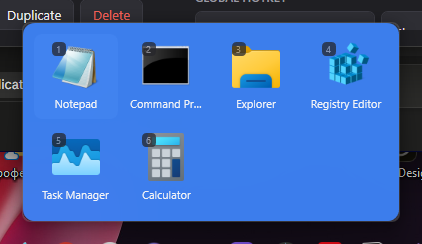

# TaskbarFold

Taskbar mini-folders for Windows 10 and 11. Click a pinned group, get a compact flyout
of application icons — like folders on a phone. Click an icon, the application starts and
the flyout closes.

Four groups on the taskbar instead of thirty icons.



## Why

[`tjackenpacken/taskbar-groups`](https://github.com/tjackenpacken/taskbar-groups) solved
this problem and was abandoned in January 2021 — WinForms on .NET Framework 4.7.2,
written before Windows 11 existed. TaskbarFold is a fresh implementation of the same
idea, with the things that made the original frustrating addressed directly:

| taskbar-groups | TaskbarFold |
|---|---|
| A cold process start on every click | A tray resident with the window already built |
| No DPI awareness, sizes in raw pixels | Per-monitor v2, every size in DIP |
| Monitor index computed incorrectly | Taskbar edge derived per monitor from its work area |
| A group's identity is its name | Immutable GUID, with the display name separate |
| Config next to the .exe, needs UAC | `%APPDATA%\TaskbarFold`, never elevated |
| Blocking HTTP request in a UI constructor | Update check is async and throttled to daily |
| Pinning takes four manual steps | One button, then a single drag |
| Icon order only via the settings window | Drag to reorder inside the flyout |
| No search | Type to filter, digits 1–9 to launch |
| A broken path is a permanent broken icon | Relocated applications are found and rebound |

Site: [taskbarfold.duckapps.ru](https://taskbarfold.duckapps.ru/en/)
([по-русски](https://taskbarfold.duckapps.ru/)).

## Install

Grab the installer or the portable zip from
[Releases](https://github.com/stavtime/taskbarfold/releases). The installer is per-user
and never asks for administrator rights. The portable build is a single self-contained
`TaskbarFold.exe` with no .NET prerequisite.

## Use

1. Run `TaskbarFold.exe`. Settings open and the app sits in the tray.
2. **New** → name the group, pick a colour, set the number of columns. For the icon,
   pick an emoji, type your own (`Win`+`.` opens the Windows emoji panel), or choose an
   image file. Without either, the tile shows the group's initial.
3. Add shortcuts: **Add file…**, drag them in from Explorer, or double-click an entry in
   **Installed applications** (Store apps included).
4. **Prepare shortcut**. Explorer opens with the generated `.lnk` selected — drag it onto
   the taskbar, or right-click it and choose *Pin to taskbar*.

Clicking the pinned button opens the flyout. Inside it:

| Key | Action |
|---|---|
| Type any letter | Filter the group |
| `1`–`9` | Launch by position |
| Arrows | Move the selection |
| `Enter` | Launch the selection |
| `Esc` | Clear the filter, then close |
| Right-click a tile | Run as administrator, open file location, remove |
| Drag a tile | Reorder, saved immediately |

### Changing the icon of a group that is already pinned

Editing a group's emoji, colour or name rebuilds its `.ico` immediately and repoints both
the generated shortcut and the copy Windows made when you pinned it. New pins, the Start
menu and Explorer all show the new icon straight away.

A button that is **already on the taskbar** is the exception: Explorer keeps its picture
in its own taskband cache and does not reload it when the shortcut changes — neither
`SHChangeNotify` nor `ie4uinit -show` dislodges it. Use **Refresh pinned taskbar icons**
in the tray menu, which offers to restart Explorer, or simply sign out and back in.

### Why pinning is not one click

Windows 10 and 11 deliberately removed the API for pinning to the taskbar, and the
registry and `LayoutModification.xml` workarounds are unreliable and break with feature
updates. Rather than ship something that quietly stops working, TaskbarFold prepares the
shortcut correctly — with the group's own `AppUserModelID` and a multi-resolution icon —
and hands it to you highlighted in Explorer. The last drag is yours.

## How it works

```
TaskbarFold.exe                 Settings window; the resident sits in the tray
TaskbarFold.exe --group <GUID>  Signals the resident to show that group
TaskbarFold.exe --tray          Starts the resident without opening settings
```

The pinned shortcut runs the `--group` form. That process creates no UI at all: it
connects to the per-user named pipe `TaskbarFold.{SID}`, sends the group id and the
cursor position, and exits. The resident shows a window it built at startup. If no
resident is listening it starts one and retries exactly once.

Each group's `AppUserModelID` is `TaskbarFold.Group.{guid}`. Without a distinct value per
group, Windows collapses every pinned group into a single taskbar button, since they all
point at the same executable.

## Building

Requires the .NET 8 SDK on Windows.

```bash
dotnet test TaskbarFold.sln
```

```bash
dotnet publish src/TaskbarFold.App/TaskbarFold.App.csproj -c Release -o artifacts/publish
```

The result is a single self-contained `artifacts/publish/TaskbarFold.exe`.

### Layout

```
src/TaskbarFold.Core/     Domain logic and Win32 wrappers — no UI framework
  Models/                 Group, Shortcut, AppSettings, TaskbarLayout
  Services/               GroupRepository, ShortcutResolver, IconCache
  Interop/                ShellLink, IconExtractor, TaskbarInfo, AppxResolver
src/TaskbarFold.App/      WPF: windows, view models, tray, entry point
tests/TaskbarFold.Tests/  xUnit over Core
```

`TaskbarFold.Core` never references WPF and never opens a window. The interop wrappers
return plain models rather than handles, which is what makes the domain layer testable
without a display.

## Update notifications

Once a day the resident fetches a small static file and compares its version with the
running build. If a newer one is published it shows a tray notification; clicking it
opens the download page. Settings has the current version, a **Check now** button that
ignores the daily throttle, and a switch to turn the whole thing off.

The feed is `https://taskbarfold.duckapps.ru/latest.json` — a plain file, not the GitHub
API. The API allows 60 unauthenticated requests an hour per IP, so a single office behind
one NAT would exhaust it and every machine behind that address would quietly stop
checking. A static file is CDN-served and has no such limit, and announcing a release is
one file edit — which also means an announcement can be held back or rolled back without
touching the release itself.

```json
{
  "version": "0.2.0",
  "url": "https://github.com/stavtime/taskbarfold/releases/tag/v0.2.0",
  "notes": "Emoji icons for groups"
}
```

`notes` is optional and appears in the notification. Unknown fields are ignored, so the
format can grow without breaking copies already installed. Only an absolute `https://`
link is ever opened, whatever the feed says. A version that cannot be parsed is treated
as "no update", never as one.

### Publishing a release

The version comes from the git tag. Nothing else needs editing — CI passes it to the
build and to the installer, and fails if the binary it produced disagrees with the tag.
A build carrying the wrong number would report an update to itself for ever.

```bash
git tag v0.2.0 && git push origin v0.2.0
```

That builds the artifacts and creates the GitHub release. Publishing the release then
triggers `publish-feed`, which writes `latest.json` to the site over SSH and reads it
back over the public URL to confirm users will actually receive it.

**Announcing is a separate act from releasing.** Until `latest.json` changes, nobody is
told anything — which is what makes it possible to publish a release quietly, add the
announcement later, and retract it if the release turns out to be bad. To retract, run
the **Publish update feed** workflow manually with the previous version number: existing
installations go back to seeing themselves as current.

The manual run also takes an optional one-line note, which appears in the notification.

Required repository secrets:

| Secret | Purpose |
|---|---|
| `DEPLOY_HOST`, `DEPLOY_USER`, `DEPLOY_PATH` | Where to copy `latest.json` |
| `DEPLOY_KEY` | Private key for that account |
| `DEPLOY_PORT` | Optional, defaults to 22 |
| `DEPLOY_KNOWN_HOSTS` | Optional but recommended — pins the host key instead of trusting it on first use |

Set the repository variable `FEED_URL` if the public address ever differs from the
default.

### Managed deployments

Where an organisation rolls out versions itself, telling users about a release they
cannot install is worse than silence. Both values are read from
`HKLM\SOFTWARE\Policies\TaskbarFold`, so setting them takes administrator rights or Group
Policy — which is the point. The same path under `HKCU` is read as a fallback, though
Windows protects the `Policies` hive from ordinary users, so in practice it is HKLM.

| Value | Type | Effect |
|---|---|---|
| `DisableUpdateCheck` | `DWORD` = 1 | No checks at all; the setting is disabled and explained in the UI |
| `UpdateFeedUrl` | `String` | Point at your own feed (absolute HTTPS only) |

The installer supports unattended deployment:

```bash
TaskbarFold-0.1.0-setup.exe /VERYSILENT /SUPPRESSMSGBOXES /NORESTART
```

## Configuration

`%APPDATA%\TaskbarFold\groups.json`, written atomically and versioned. Every save keeps
the outgoing file as `groups.json.bak`, a file that cannot be parsed is set aside as
`groups.corrupt-<timestamp>.json` rather than overwritten, and a file written by a newer
build is left untouched.

```jsonc
{
  "version": 1,
  "settings": { "theme": "System", "iconSize": 48, "showLabels": true },
  "groups": [
    {
      "id": "b3f1…",
      "name": "Work",
      "columns": 5,
      "background": "#1F1F23",
      "opacity": 0.92,
      "shortcuts": [
        {
          "id": "a7c2…",
          "displayName": "Photoshop",
          "target": "C:\\Program Files\\Adobe\\Photoshop.exe",
          "fallbackFileName": "Photoshop.exe"
        }
      ]
    }
  ]
}
```

`fallbackFileName` is what lets a moved application be found again after an update
instead of leaving a dead icon behind.

## License

MIT. See [LICENSE](LICENSE).
